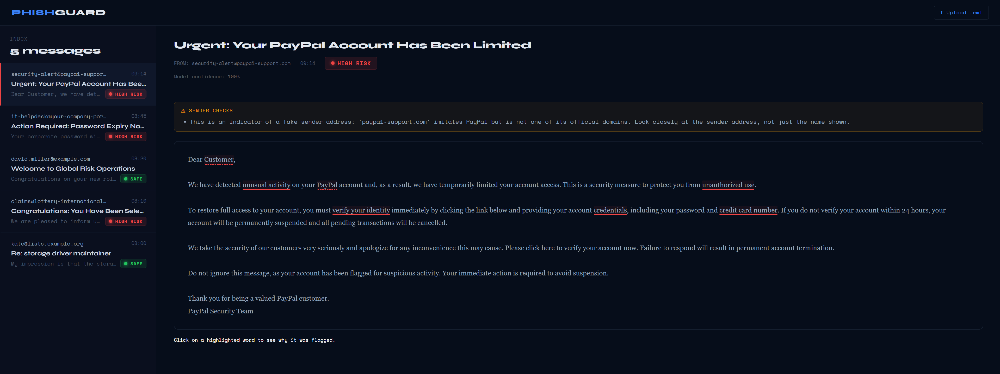
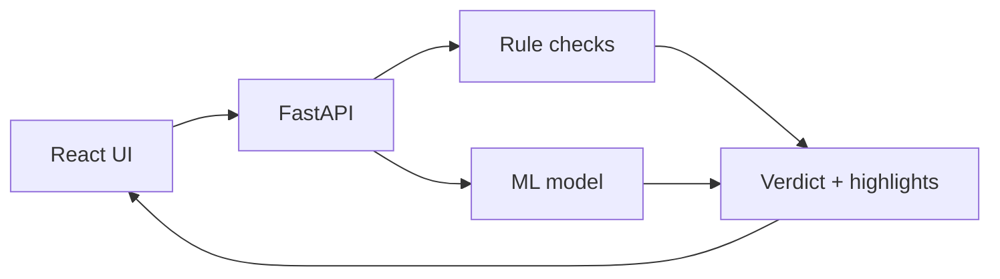

# PhishGuard

PhishGuard checks emails for phishing and shows you *why* it thinks an email is suspicious: it highlights the relevant passages and explains them in plain language.

It started as a university project on intelligent user interfaces, so the explanations are the main point. They are written for people without a technical background and never claim certainty.

> PhishGuard only works with English emails. It's a research and demo project, not a replacement for a real spam filter.



## What it does

- Highlights suspicious passages in the email. Click one to see the explanation. Solid underlines come from fixed rules, dashed ones from the model.
- Combines simple rules (urgency, password requests, fake links, fake senders) with a machine learning model. If the two disagree, it says "uncertain" instead of guessing.
- Lets you upload real `.eml` files, which also allows checks on the sender, on hidden link targets and on where replies would go.
- Offers four models you can switch between, and can optionally use an LLM (local or via API) to phrase explanations.

## How it works



The model decides whether an email is phishing. The rules can only raise the risk: if the model says "legitimate" but the rules find strong warning signs, the email is marked as uncertain.

The highlights from the model are found by removing one word at a time and measuring how much the verdict changes (for the small models: LIME). Filler words like "account" or "email" are never highlighted.

## Getting started

You need [Docker](https://docs.docker.com/get-docker/).

```bash
docker compose up --build
```

Then open http://localhost:5173. The first analysis downloads the default model (about 270 MB). The API and its interactive docs are at http://localhost:8000/docs.

## Local development

You need Python 3.13 and Node.js 24. If you have `make`, `make help` lists the common commands.

**Backend**

```bash
cd backend
python -m venv .venv
source .venv/bin/activate        # Windows: .venv\Scripts\activate
pip install -r requirements-dev.txt
uvicorn app.main:app --reload    # http://localhost:8000
```

**Frontend**

```bash
cd frontend
npm install
npm run dev                      # http://localhost:5173
```

**Tests and linting**

```bash
cd backend
python -m pytest
ruff check .
cd ../frontend
npm run lint
```

`make check` runs the same checks as the CI.

## Settings

Settings go into `backend/.env`. Copy `backend/.env.example` to start; it explains every option. Restart the backend after a change.

- `DEFAULT_MODEL` picks the model:
  - `cybersectony_distilbert` (default) and `dima806_distilbert` are pretrained and download themselves.
  - `logistic_regression` and `random_forest` have to be trained first (see below).
- `LLM_PROVIDER` turns on AI-written explanations (off by default). Use `openai` for Ollama or any OpenAI-compatible API, or `anthropic` for Claude. Only the highlighted words and one sentence around them are sent, never the whole email.

## Training your own models

The training data is the [Phishing Email Curated Datasets](https://zenodo.org/records/8339691). Download `Nazario.csv`, `Nigerian_Fraud.csv`, `Enron.csv` and `SpamAssasin.csv` (spelled like this on Zenodo) into `backend/data/`, then:

```bash
cd backend
python -m scripts.prepare_data   # merges and cleans the data
python -m scripts.train          # writes backend/artifacts/*.pkl
python -m scripts.evaluate       # compares all models, results in reports/
```

PhishGuard looks for phishing, not general spam, so only Nazario and Nigerian Fraud count as phishing. The first evaluation with the large models takes around 50 minutes on a normal CPU; after that, results are cached.

**Own test set (optional).** The training data is old, so there is also a small set of recent emails:

```bash
python -m scripts.fetch_phishing_pot     # recent phishing from Phishing Pot
python -m scripts.fetch_mailing_lists    # normal emails from public Apache mailing lists
python -m scripts.anonymize_emails       # removes names, addresses and tracking links
python -m scripts.evaluate_own
```

No data, models or results are stored in this repository.

## API

| Endpoint | What it does |
|---|---|
| `POST /analyze` | Analyzes text: `{"content": "...", "sender": "..."}`. `sender` and `model` are optional. |
| `POST /analyze-eml` | Analyzes a complete `.eml` file sent as the request body. |
| `GET /models` | Lists the available models. |
| `GET /emails` | Returns the demo emails. |
| `POST /simulate-incoming` | Returns a new phishing email for demos. |

```bash
curl -X POST --data-binary @mail.eml http://localhost:8000/analyze-eml
```

The answer contains `label` (`phishing` or `legitimate`), `risk` (`low`, `medium`, `high`), `uncertain`, and `reasons`: one entry per highlight with the passage, its explanation and its position in the text. Non-English emails get status `422`.

## Results

Measured in November 2026. Recall is the share of phishing emails that were caught.

| Model | Recall, random split | Recall, unseen collections | Recall, own test set | False alarms, own test set | Time per email |
|---|---|---|---|---|---|
| cybersectony DistilBERT (default) | 0.95 | 0.93 | 0.98 [0.88–1.00] | 0.02 [0.00–0.09] | 199 ms |
| dima806 DistilBERT | 0.97 | 0.95 | 1.00 [0.92–1.00] | 0.02 [0.00–0.09] | 92 ms |
| Logistic Regression | 0.99 | 0.53 | 0.70 [0.56–0.82] | 0.00 [0.00–0.06] | 3 ms |
| Random Forest | 0.99 | 0.35 | 0.82 [0.68–0.90] | 0.08 [0.04–0.18] | 143 ms |

"Unseen collections" means the model was tested on email collections it was not trained on. The own test set has 44 phishing and 59 normal emails from 2026 that no model has seen; the brackets are 95% confidence intervals.

## What I learned

- **Test your assumptions.** I suspected text formatting caused wrong predictions. A quick test showed it made no difference.
- **A random test split can be misleading.** My first models scored 99%, but on email collections they hadn't seen they caught only about half of the phishing. They had partly learned the writing style of each collection.
- **Language matters a lot.** On non-English phishing the simple models did much worse, so PhishGuard now only accepts English.
- **Don't trust model descriptions blindly.** One pretrained model had seen almost half of my test emails during training. It still performed well on the rest, but I only knew that after checking.
- **Rules age quickly.** My rules were written for classic phishing and missed most current scams.

## Limitations

- English emails only
- The test set is small and doesn't include tricky everyday emails like password resets or delivery notices
- Sender checks only know a short list of brands
- The UI is still a prototype

## Credits

The training data comes from the [Phishing Email Curated Datasets](https://zenodo.org/records/8339691) (CC BY 4.0). Please cite:

1. A. I. Champa, M. F. Rabbi, and M. F. Zibran, "Why phishing emails escape detection: A closer look at the failure points," in *12th International Symposium on Digital Forensics and Security (ISDFS)*, 2024, pp. 1–6.
2. A. I. Champa, M. F. Rabbi, and M. F. Zibran, "Curated datasets and feature analysis for phishing email detection with machine learning," in *3rd IEEE International Conference on Computing and Machine Intelligence (ICMI)*, 2024, pp. 1–7.

Test emails come from [Phishing Pot](https://github.com/rf-peixoto/phishing_pot) (CC BY-NC 4.0) and public [Apache mailing lists](https://lists.apache.org). The pretrained models are by [cybersectony](https://huggingface.co/cybersectony/phishing-email-detection-distilbert_v2.4.1) and [dima806](https://huggingface.co/dima806/phishing-email-detection).

## License

MIT, see [LICENSE](LICENSE).
